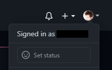
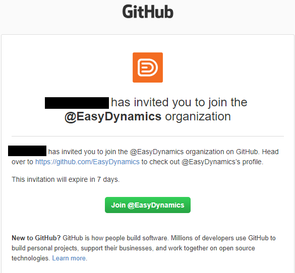

# GitHub Access
--- 
Our public repositories can be found on the [Easy Dynamics GitHub Organization](https://github.com/EasyDynamics) page.

If you need access to a private repository or one of the Easy Dynamics GitHub organizations, follow the process below.

## Table of contents
{: .no_toc .text-delta }

1. TOC
{:toc}

## GitHub Sign In
Make sure you're signed in to GitHub before requesting access.

Check the top-right area of GitHub to confirm you're signed in.

If not, use the button below.

[Sign in to GitHub](https://github.com/login?return_to=%2FEasyDynamics){: .btn .btn-blue }

**NOTE:** If you do not already have a GitHub account, you will need to create one by following GitHub's instructions:

[Signing up for a new GitHub account](https://docs.github.com/en/get-started/start-your-journey/creating-an-account-on-github)

You may use your existing GitHub account. Your GitHub account will be linked to your Easy Dynamics organizational identity when you complete SAML SSO.

## Requesting GitHub Organization Access

Easy Dynamics manages GitHub organization membership through Microsoft Entra ID using **My Access, Access Packages, SAML SSO, and SCIM provisioning**.

Request access to the GitHub organization you need:

[Easy Dynamics Access Package](https://myaccess.microsoft.com/@easydynamics.onmicrosoft.com#/access-packages/99167a4e-674b-4dba-9eab-5e36954360c6){: .btn .btn-blue }

[Easy Dynamics Edge Labs Access Package](https://myaccess.microsoft.com/@easydynamics.onmicrosoft.com#/access-packages/8e656ac0-c3d1-425e-9e72-0465891fa8a0){: .btn .btn-blue }

[Easy Dynamics Archive Access Package](https://myaccess.microsoft.com/@easydynamics.onmicrosoft.com#/access-packages/1bea3c9b-eead-475c-ae3c-0d691eba76c2){: .btn .btn-blue }

Once your request is approved:

1. Microsoft Entra adds you to the appropriate GitHub organization access group.
2. SCIM automatically provisions or matches your GitHub identity in the requested organization.
3. GitHub sends an invitation to your Easy Dynamics email address when required.
4. You accept the invitation using your GitHub account.
5. You authenticate through Easy Dynamics SAML SSO to link your GitHub account to your Easy Dynamics organizational identity.

There is normally no need for IT or a GitHub Organization Owner to manually invite standard organization members.

## Accepting the GitHub Invitation

After your access request is approved, GitHub may send an organization invitation to your **Easy Dynamics email address**.

The email should look similar to the example below:

**NOTE:** The invitation is sent by GitHub, typically from **noreply@github.com**. Check your spam or junk folder if you do not see it.

Your Easy Dynamics email address must be associated with your GitHub account before you can accept an invitation sent to that address.

When you click the **Join** link in the invitation:

1. Sign in with your existing GitHub account, or create one if necessary.
2. Accept the organization invitation.
3. Complete the Easy Dynamics SAML SSO authentication when prompted.

Once SSO is completed, your GitHub account is linked to your Easy Dynamics organizational identity for access to that GitHub organization.

All GitHub accounts accessing Easy Dynamics organizations must meet applicable account security and two-factor authentication requirements.

For more information, see:

[Securing your GitHub account with two-factor authentication](https://docs.github.com/en/authentication/securing-your-account-with-two-factor-authentication-2fa)

## External Users

External users who are not Easy Dynamics employees must use an **Easy Dynamics-managed account** for access to Easy Dynamics GitHub resources.

If you are an external user and do not have an Easy Dynamics-managed account, contact IT before requesting GitHub access.

External users are granted access as **outside collaborators** rather than GitHub organization members.

## Requesting Access to Private Repositories as a Member

Being a member of a GitHub organization does not automatically grant access to every private repository.

If you are already a member of the appropriate GitHub organization but cannot access a repository you need, submit a repository access request.

The form will ask for:

| GitHub Username  | The username of the GitHub user that needs access to the repository   |
| Repository Link  | The link/URL to the repository                                        |
| Permission Level | The desired permission level                                          |

You may only specify one of the following permission levels:
- Read
- Triage
- Write
- Maintain
- Admin

For more information, see: 
[Permission levels for repositories owned by an organization](https://docs.github.com/en/free-pro-team@latest/github/setting-up-and-managing-organizations-and-teams/repository-permission-levels-for-an-organization#permission-levels-for-repositories-owned-by-an-organization).

Click the button below to submit a request to our IT department.

[Request access to a repository](https://forms.office.com/Pages/ResponsePage.aspx?id=8Wo4mFHcgkyTO7heYqkRyjhRBif4ALJMuscRyCOYweNUM1JDWUJNTDJDRDZEUUY1UkhNMFZZVlpUWSQlQCN0PWcu){: .btn .btn-blue }
